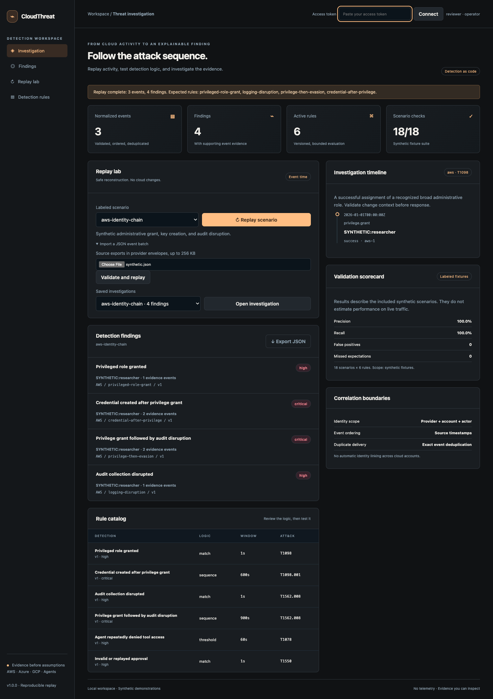
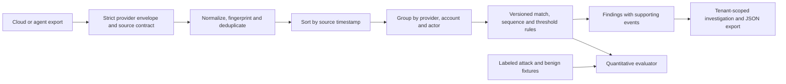

# CloudThreat Lab

**Detection as code, replay, and investigation for cloud and agent activity.**

Normalize supplied AWS, Azure, GCP, and MCP Sentinel audit exports. Replay events in source-time order, evaluate versioned deterministic rules, inspect the exact evidence, and quantify results against labeled attack and benign scenarios.

[](https://github.com/jayekwere/cloudthreat-lab/actions/workflows/verify.yml) [MIT](LICENSE)



## Try it

Requires Node 24 and npm, or Docker with Compose. No cloud account, credential, or billable resource is needed.

```sh
git clone https://github.com/jayekwere/cloudthreat-lab.git
cd cloudthreat-lab
npm ci --ignore-scripts
npm run verify
DEMO=1 npm start
```

Open **http://127.0.0.1:4320**, connect the terminal's **analyst** or **operator** token, and replay `aws-identity-chain`. The investigation shows three normalized events and four findings. Select a finding to inspect the source evidence. Replay `aws-benign-read` to see the benign control produce zero findings. Saved investigations remain tenant scoped, and JSON export includes rule and input digests.

```sh
docker compose up --build
docker compose logs
# Stop the local demonstration:
docker compose down
```

Demo tokens expire after fifteen minutes. Restart for new credentials. Demo state is in memory. For a headless check, `npm run demo` replays all labeled scenarios and fails on a false positive or missed expectation. To replay your own synthetic batch:

```sh
node --import tsx scripts/replay.ts fixtures/aws-attack.json
```

## Detection coverage

| Rule                         | Logic          | Evidence and boundary                                                                 |
| ---------------------------- | -------------- | ------------------------------------------------------------------------------------- |
| `privileged-role-grant`      | Match          | Successful recognized broad role assignment, with explicit role context               |
| `credential-after-privilege` | Sequence, 600s | Broad grant then credential creation by the same provider/account/actor               |
| `logging-disruption`         | Match          | Successful trail stop/deletion, diagnostic-setting deletion, or logging sink deletion |
| `privilege-then-evasion`     | Sequence, 900s | Broad grant followed by logging disruption                                            |
| `agent-denial-burst`         | Threshold, 60s | At least five distinct denied agent tool calls                                        |
| `invalid-approval-use`       | Match          | A gateway audit record reporting an invalid approval                                  |

Rules are strict JSON data under [rules/detections.json](rules/detections.json), with version, explanation, severity, technique, kind, step predicates, and time window. No evaluated expressions, executable rules, or unbounded regular expressions are accepted. ATT&CK mappings describe observed behaviors; they do not establish malicious intent.

| Source   | Implemented export coverage                                                                                                                    |
| -------- | ---------------------------------------------------------------------------------------------------------------------------------------------- |
| AWS      | CloudTrail-shaped IAM broad managed-policy attachments, access-key creation, and CloudTrail stop/deletion; failed operations excluded          |
| Azure    | REST-shaped Activity Log role assignments and diagnostic-setting deletion; broad role classification requires supplied role-definition context |
| GCP      | Selected AuditLog IAM-policy changes, service-account key creation, and logging sink deletion, with service-name checks                        |
| Sentinel | Actual synthetic exported gateway audit entries for tool denials and invalid approvals                                                         |

[Source contracts and limitations](docs/EVENTS.md) list every field and supported operation. These are export adapters, not live collectors. Azure identity-directory credential logs, arbitrary GCP policy representations, all AWS privilege-escalation paths, and cloud account provisioning are not implemented.

## Measured fixture results

The included **18 scenarios × 6 rules = 108 scenario-rule checks** produced:

| Metric                          | Result    |
| ------------------------------- | --------- |
| True positive rule expectations | 18        |
| False positives                 | 0         |
| Missed expectations             | 0         |
| True negatives                  | 90        |
| Precision / recall              | 1.0 / 1.0 |

These measurements apply only to the versioned synthetic fixtures. They do not estimate live traffic precision, recall, or attack coverage. A scenario-rule pair counts once even if multiple findings match the same rule. Tests deliberately inject wrong labels to prove the evaluator reports false positives and misses. [Complete recorded output](evidence/demo.json) includes each expected and actual rule set.

The AWS attack replay produces:

```text
3 normalized events
privileged-role-grant       high      [aws-1]
credential-after-privilege   critical  [aws-1, aws-2]
privilege-then-evasion       critical  [aws-1, aws-3]
logging-disruption          high      [aws-3]
```

## Architecture



The replay engine is stateless and deterministic. HTTP investigations are durably stored in SQLite with input and rule digests; a separate authenticated audit trail records replay and deletion. The secure API uses signed tokens, server-owned roles, tenant predicates, request limits, strict origins, and bounded state. The browser renders untrusted strings as text.

## Validate and integrate

`npm test` covers source contracts, failures, duplicates and conflicts, ordering, exact time boundaries, actor/account/provider isolation, threshold suppression, malicious rule fields, quantitative scoring, signed-token constraints, API roles, atomicity, persistence primitives, and tenant isolation. `npm run test:coverage` generates a coverage report. Browser tests validate attack and benign replay, evidence selection, desktop and mobile layout. Container smoke tests exercise a real restricted image and cross-tenant access denial.

```sh
npx playwright install chromium
npm run test:browser
docker build -t cloudthreat-lab:local .
node scripts/container-smoke.mjs cloudthreat-lab:local
```

To replay synthetic gateway activity across both projects, run Sentinel's `npm run demo -- --write`, copy its `evidence/sentinel-events.json` to this checkout, and pass that file to `scripts/replay.ts`. [fixtures/sentinel-export.json](fixtures/sentinel-export.json) is a captured, tested example from that workflow. Imported hash fields are treated as supplied data, not cryptographic proof of origin.

See [validation evidence](evidence/VALIDATION.md), [threat model](docs/THREAT-MODEL.md), [architecture](docs/ARCHITECTURE.md), [event contracts](docs/EVENTS.md), [API](docs/API.md), [design decisions](docs/DESIGN-DECISIONS.md), and [operations](docs/OPERATIONS.md).

## Limits

This is a bounded single-node replay service with production-style controls, not a live SIEM or an independently audited production platform. No cloud credentials, collectors, deployment into cloud accounts, automatic response, or model-generated verdicts are included. The engine cannot detect events that are missing, malformed, unsupported, outside a batch, or lacking required role context. Separate API runs do not correlate across history.

Correlation uses exact provider/account/actor strings. There is no cross-cloud identity graph, target-principal attribution, session alias resolution, geolocation baseline, or inferred identity linking. Events at identical timestamps cannot establish a sequence. Successful administrative changes may be authorized; these rules require contextual investigation. Sequence rules choose the earliest later match for each first step, and threshold rules suppress overlapping windows. Review [algorithm details](docs/ARCHITECTURE.md) before interpreting counts.

Each batch has at most 2,000 records and the HTTP body limit is 256 KiB. Each tenant can retain at most 100 investigations until an operator deletes some. Rate limits are process local. Audit history needs retention management and independent checkpoints. Detection metrics remain fixture scoped.

See [SECURITY.md](SECURITY.md) for reporting and [CONTRIBUTING.md](CONTRIBUTING.md) for changes. Licensed under [MIT](LICENSE).

---

**AI assistance:** AI tools helped with code or documentation.
